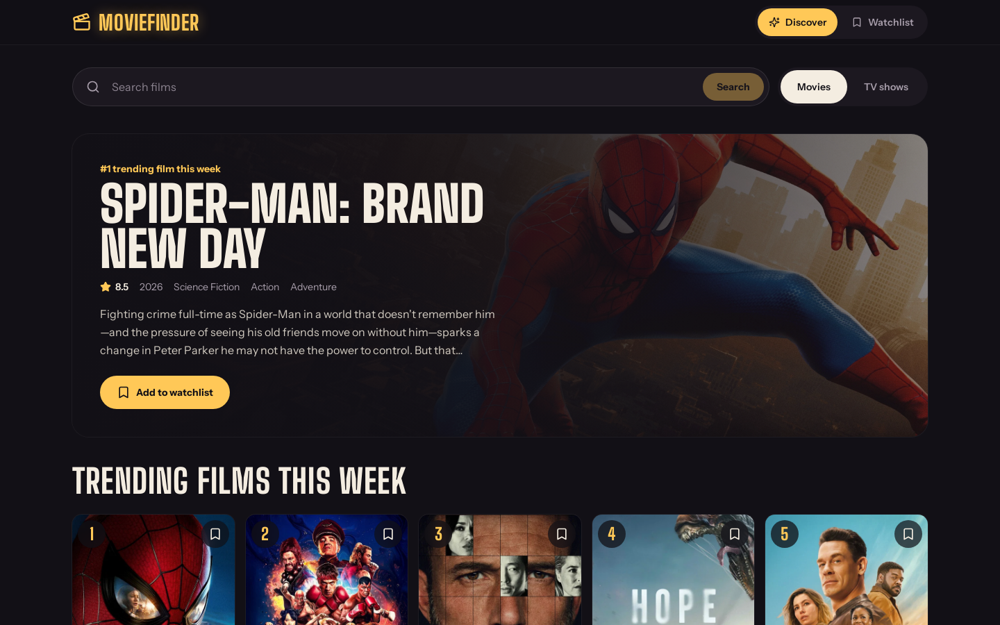
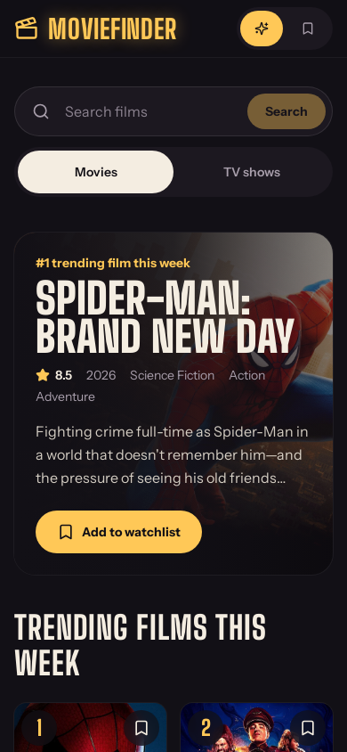

<div align="center">

# 🎬 MovieFinder: Movie & TV Search

Search millions of movies and TV shows, browse what's trending this week, and keep a personal watchlist. Built with Next.js, React and The Movie Database (TMDB) API.


**[▶ Live demo: moviefinder-zain.vercel.app](https://moviefinder-zain.vercel.app)**

&nbsp;

</div>

---

## Design

A late-night cinema look: near-black background, marquee-bulb yellow accents and tall condensed headings (Big Shoulders Display) with Instrument Sans for reading text.

- **Featured hero:** this week's #1 title with its backdrop, rating, genres, overview and a watchlist button
- **Ranked poster grid:** trending titles carry a 1–10 badge; hover or focus a poster to read the overview; bookmark straight from the poster
- **Ticket-stub watchlist:** saved titles appear as tickets with a perforated edge
- **Clear states:** loading skeletons, a friendly "nothing found" message, and a "Couldn't reach the movie database" panel with a **Try again** button when the API is offline
- **Accessible:** labelled buttons, keyboard focus rings, screen-reader text for ranks and ratings, reduced-motion support

## Features

- **Search movies or TV shows:** switch between the two with a toggle and search by title
- **Trending this week:** the home page shows the top 10 trending movies or shows
- **Rich cards:** poster, title, release year, rating and up to two genres; hover to read the overview
- **Watchlist:** add or remove titles with one click; the list is saved in your browser (`localStorage`) and has its own tab
- **Pagination:** page through long search results (up to TMDB's 500-page limit)
- **Loading and empty states,** plus a responsive grid that works on phones and desktops

## Tech stack

| Layer | Tools |
|---|---|
| Framework | Next.js 16 (App Router), React 19 |
| Language | TypeScript |
| UI | Tailwind CSS 4, Lucide icons, Big Shoulders Display + Instrument Sans via Fontsource |
| Data | [TMDB API v3](https://developer.themoviedb.org/docs) |
| Storage | Browser `localStorage` for the watchlist |

## Getting started

**Requirements:** Node.js 18.18 or newer and a free TMDB API key ([get one here](https://www.themoviedb.org/settings/api)).

```bash
git clone https://github.com/ZainAftab-dev/Movie-Search-App.git
cd Movie-Search-App
npm install
```

Put your API key in `lib/tmdb.ts`:

```ts
export const TMDB_API_KEY = "your_tmdb_api_key"
```

Then start the app:

```bash
npm run dev
```

Open [http://localhost:3000](http://localhost:3000). For a production build: `npm run build` then `npm start`.

## TMDB endpoints used

| Endpoint | Used for |
|---|---|
| `GET /trending/movie/week` | Trending movies on the home page |
| `GET /trending/tv/week` | Trending TV shows on the home page |
| `GET /search/movie` | Movie search with pagination |
| `GET /search/tv` | TV search with pagination |

Posters are loaded from `image.tmdb.org`.

## Project structure

```
app/
├── layout.tsx            # root layout and metadata
├── page.tsx              # renders <MovieApp /> inside Suspense
├── loading.tsx           # loading state
└── globals.css
components/
├── movie-app.tsx         # state: query, media type, results, pages, active tab, error/retry
├── featured.tsx          # hero for the #1 trending title
├── header.tsx            # logo and Discover / Watchlist tabs
├── search-bar.tsx        # search input with Movies / TV Shows toggle
├── movie-list.tsx        # results grid
├── movie-card.tsx        # poster card with rating, genres, overview and watchlist button
├── pagination.tsx        # page controls
└── watchlist.tsx         # saved titles
hooks/
└── use-watchlist.ts      # watchlist state synced with localStorage
lib/
└── tmdb.ts               # API calls, types and genre names
```

## Deployment

Live at [moviefinder-zain.vercel.app](https://moviefinder-zain.vercel.app). To deploy your own copy, import the repository into [Vercel](https://vercel.com/new) and deploy with the default settings.

## Credits

This product uses the TMDB API but is not endorsed or certified by TMDB.

## Screenshots

The screenshots above are taken from the live site by the **Update screenshots** GitHub Action (`.github/workflows/screenshots.yml`). Run it from the Actions tab to refresh them after a redesign.

## Author

**Zain Aftab** · [GitHub](https://github.com/ZainAftab-dev) · [LinkedIn](https://www.linkedin.com/in/zain-aftab-563727295/)

## License

[MIT](LICENSE)
